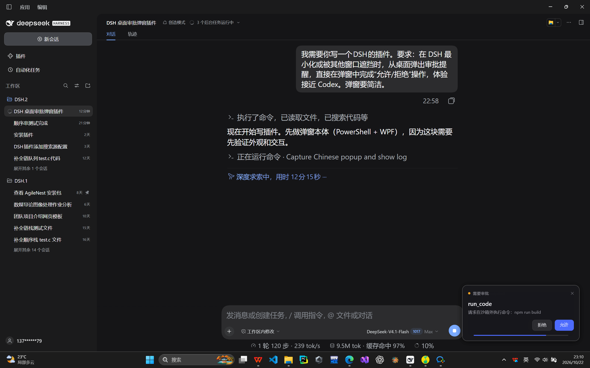

# 桌面审批弹窗（dsh-approval-popup）

当 DeepSeek Harness 最小化、被其他窗口遮挡或不在前台时，在桌面右下角弹出
一张紧凑的审批卡片，可以直接点「允许」或「拒绝」，不需要切回主窗口。
样式接近 Codex 的桌面审批提示。



## 行为

- 仅在 DSH 不处于前台时显示；DSH 在前台时完全交给 Web UI 的审批条。
- 卡片置顶显示在屏幕右下角，不抢键盘焦点，不闪烁任务栏。
- 鼠标点「允许」→ 返回 `allowed-once`；点「拒绝」、右上角 ✕ 或按 Esc →
  返回 `rejected`。
- 倒计时条走完后卡片自动关闭，请求交回 Web UI，不会自动批准。
- 多个审批同时到达时按顺序逐个显示，避免叠一屏卡片。
- 请求被取消（`AbortSignal`）时立即关闭对应卡片。

## 安装

要求：Windows 10/11，DSH Desktop，系统自带的 PowerShell 5.1。

```powershell
git clone https://github.com/aUsernamecannotbeblank/dsh-approval-popup.git
```

在 DSH 的「插件」设置里选择安装本地插件目录；或让 DSH Agent 执行
（把路径换成克隆下来的目录）：

```text
plugin_manager install_bundle target=D:\path\to\dsh-approval-popup
```

安装后本插件会自动挂载，无需重启。卸载后不会残留后台进程。

已在 Windows 11、150% 缩放、DSH Desktop 上实测：DSH 被其他窗口遮挡时，
真实的 `pwsh` 提权审批会弹出本卡片，点击「允许」后命令继续执行，且只出现
一张卡片（`dsh-attention` 不会重复弹）。

## 配置

安装后可在 `cordis.patch.yml` 的 `config` 中覆盖以下字段（均有默认值），
修改后重载插件即可生效：

| 字段 | 默认值 | 说明 |
| --- | --- | --- |
| `enabled` | `true` | 关闭后不再注册审批监听 |
| `lang` | `zh` | `zh` 或 `en` |
| `timeoutSec` | `60` | 卡片倒计时秒数；`0` 表示不自动关闭 |
| `sound` | `false` | 弹出时播放系统提示音 |
| `focusWindow` | `false` | 弹出时是否抢占焦点（一般保持 `false`） |
| `showWhenFocused` | `false` | 调试用：DSH 在前台时也显示卡片 |
| `labels.zh` / `labels.en` | 内置 | 覆盖 `heading` / `allow` / `deny` 文案 |

## 与 dsh-attention 的关系

如果同时安装了 `dsh-attention`，它也会监听审批并弹自己的卡片。本插件以
`prepend` 方式注册，正常情况下会先拿到请求，`dsh-attention` 不会再弹第二张卡。

如果仍看到两张卡片，请在 `dsh-attention` 的配置里把 `notifyApproval` 设为
`false`，保留它的提问提醒和完成提醒即可。

## 实现

- `index.js`：宿主侧 Cordis 插件，监听 `approval/request`，串行拉起卡片进程。
- `scripts/popup.ps1`：PowerShell 5.1 + WPF 绘制的无边框卡片，通过环境变量
  接收 base64 JSON，stdout 返回 `{"decision":"allow"|"deny"|"timeout"}`。
- `cordis.patch.yml`：把插件插入当前 profile 的默认配置。

卡片只在本地进程间通过环境变量和 stdout 传递，不访问网络，不写入审批历史。
